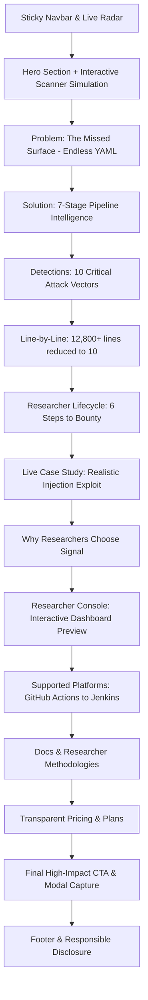

# Signal — CI/CD Vulnerability Scanner

> **The Bug Bounty & Security Research Landing Page**  
> *"Stop reviewing CI/CD pipelines line by line. Find your next bounty in CI/CD."*

---

## 🎯 Executive Overview & Project Goal

**Signal** (`cicd-vulnerability-scanner`) is a specialized developer security and bug bounty reconnaissance tool designed specifically for security researchers, penetration testers, and bug bounty hunters. 

While most application security programs focus heavily on the application code or API endpoints, modern CI/CD pipelines (such as GitHub Actions, GitLab CI, and Jenkins) represent an enormous, overlooked attack surface filled with:
- Excessive permissions (`contents: write`, `id-token: write`)
- Workflow injection via untrusted triggers (`pull_request_target`, `workflow_run`, `issue_comment`)
- Hardcoded or weakly protected cloud secrets and tokens
- Unpinned third-party actions susceptible to supply chain compromise
- Vulnerable self-hosted runner infrastructure

### Your Primary Task
Your main mission in this repository is to build, polish, and deploy an **ultra-premium, high-converting product landing page** that communicates the value proposition to researchers, demonstrates live scanning capabilities through interactive UI mocks, and captures early interest or researcher signups.

---

## 🛠️ Tech Stack & Tooling

| Layer | Technology | Version | Purpose |
| :--- | :--- | :--- | :--- |
| **Framework** | [React](https://react.dev/) | `19.2` | Core UI component hierarchy and state management |
| **Language** | [TypeScript](https://www.typescriptlang.org/) | `6.0` | Strict type definitions and safe schema definitions |
| **Build Tool** | [Vite](https://vite.dev/) | `8.3` | Ultra-fast HMR and production bundling |
| **Styling** | [Tailwind CSS v4](https://tailwindcss.com/) | `4.3` | Modern `@theme` configuration, zero-runtime CSS |
| **Icons** | [Lucide React](https://lucide.dev/) | `^1.52` | Crisp, modern cybersecurity and UI glyphs |
| **Linter** | [Oxlint](https://oxc.rs/) | `^1.81` | Ultra-fast Rust-based static analysis and linting |
| **Fonts** | Instrument Sans & IBM Plex Mono | Google Fonts | Editorial typography paired with terminal monospacing |

---

## 📐 Landing Page Master Blueprint (Section-by-Section)

The landing page follows a narrative engineered for technical credibility, high engagement, and clear conversion paths:



---

### Detailed Section Breakdown

#### 1. Header & Navigation (`src/components/Navbar.tsx`)
- **Brand Identity**: Monospace Signal badge with glowing live status indicator.
- **Anchor Navigation**: Smooth scroll anchors to `#product`, `#how-it-works`, `#detections`, `#researchers`, `#pricing`, and `#docs`.
- **Conversion Triggers**: Direct actions for *"Researcher Login"* and *"Start Scanning"* that open the non-intrusive modal dialog.

#### 2. Hero Section (`src/components/Hero.tsx` & `src/components/ScanVisual.tsx`)
- **Badge**: *"Built for Bug Bounty Hunters & Security Researchers"*.
- **Headline**: *"Find Your Next Bounty in CI/CD."* with ambient glow and gradient accents.
- **Value Prop**: Immediate clarity on shifting from manual line-by-line reading to automated security lead discovery.
- **Interactive Scanner Visual (`ScanVisual.tsx`)**:
  - Live animated parser inspecting `.github/workflows/deploy.yml`.
  - Node pipeline tracker (*Discover → Perms → Secrets → Actions → Findings*).
  - Dynamic risk score ring (SVG circular meter updating in real-time).
  - Simulated terminal output flagging high/medium/low severity leads.

#### 3. Problem Statement: "The Missed Surface" (`src/components/Problem.tsx`)
- Highlights the friction in manual research:
  1. **Endless Files**: Hundreds of workflows, shell scripts, and build manifests.
  2. **Manual Code Review**: Hours wasted reading YAML boilerplate.
  3. **Hidden Attack Surface**: Overlooked runner permissions and trigger contexts.
- Key takeaway banner: *"The pipeline is part of the attack surface."*

#### 4. The 7-Step Solution (`src/components/Solution.tsx`)
Illustrates the pipeline intelligence process:
`Repository` ➔ `CI/CD Discovery` ➔ `Workflow Analysis` ➔ `Security Detection` ➔ `Risk Prioritization` ➔ `Manual Validation` ➔ `Bug Bounty Report`.

#### 5. Detection Matrix — 10 Attack Vectors (`src/components/Detections.tsx`)
A grid showcasing the exact vulnerability categories researchers chase:
1. **Secret Exposure** (Hardcoded keys, environment leaks)
2. **Dangerous Permissions** (`contents: write`, `pull-requests: write`)
3. **Third-Party Actions** (Unpinned tags, mutable refs, malicious commits)
4. **Self-Hosted Runners** (Persistence, breakout, network pivot)
5. **Workflow Injection** (`${{ github.event.* }}` passed directly to shell steps)
6. **Supply-Chain Risks** (Untrusted upstream packages and lockfile tampering)
7. **Cloud Credentials** (Insecure AWS/GCP/Azure OIDC federation)
8. **Command Execution** (Arbitrary command execution via PR titles/branch names)
9. **Artifact & Build Risks** (Poisoned build artifacts across jobs)
10. **Security Misconfigurations** (Default branch bypasses, review exemptions)

#### 6. Line-by-Line Impact Comparison (`src/components/LineByLine.tsx`)
- Counter animation comparing:
  - **Manual Review**: 12,847 lines across 342 workflows and 89 config files (hours of work).
  - **Signal Scanner**: Automatically narrowed down to 17 suspicious locations, 6 high-priority findings, and 3 actionable leads.

#### 7. Bug Bounty Researcher Lifecycle (`src/components/BountyWorkflow.tsx`)
- Guides the hunter through a 6-step loop:
  `Discover` ➔ `Scan` ➔ `Investigate` ➔ `Validate` ➔ `Report` ➔ `Bounty`.

#### 8. Real-World Exploit Case Study (`src/components/ResearchExample.tsx`)
- Interactive step-by-step breakdown of an actual GitHub Actions injection vulnerability:
  - Repository context
  - Workflow path
  - Finding description
  - Impact analysis (command injection via untrusted input).

#### 9. Why Researchers Choose Signal (`src/components/WhyResearchers.tsx`)
- Focuses on the researcher persona:
  - Triage speed over false-positive clutter.
  - Zero fluff: Direct line numbers and contextual AST snippets.
  - Ethical research orientation.

#### 10. Researcher Console Preview (`src/components/DashboardMock.tsx`)
- Realistic dashboard preview displaying:
  - Repository scan header (`target-org / target-repository`).
  - Metric counters: Files scanned, Workflows parsed, Secrets detected, Severity distribution.
  - Filterable findings table with Severity badges (`HIGH`, `MEDIUM`, `LOW`), finding type, file path, and exact line number.

#### 11. Multi-Platform Support & Ecosystem Roadmap (`src/components/Supported.tsx`)
- **Active Support**: GitHub Actions.
- **Roadmap / Coming Soon**: GitLab CI/CD, Jenkins, CircleCI, Azure Pipelines, Bitbucket Pipelines.

#### 12. Documentation & Methodology (`src/components/Docs.tsx`)
- Quick links for researchers:
  - Triaging workflow injection.
  - Validating OIDC and cloud token scope.
  - Writing professional, reproducible bug bounty reports.

#### 13. Transparent Pricing Matrix (`src/components/Pricing.tsx`)
- Data-driven pricing cards configured in `src/content/site.ts`:
  - **1 Month ($39)**: Single hunt, no commitment.
  - **3 Months ($99)**: Season pass, save 15% ($33/mo).
  - **1 Year ($299 - Featured)**: For professional researchers, save 36% ($25/mo).

#### 14. High-Conversion Final CTA & Lead Capture Modal (`src/components/FinalCta.tsx` & `src/components/UiProvider.tsx`)
- Prominent call to action with animated ambient glow.
- Accessible modal dialog for repository URL input and email registration with zero-backend local preview state.

#### 15. Footer & Legal Guidelines (`src/components/Footer.tsx`)
- Site map links, researcher ethics reminder, disclaimer, and copyright.

---

## 🎨 Design System & Aesthetic Tokens

The styling is defined in `src/index.css` leveraging Tailwind CSS v4's `@theme` directive:

### Color Palette
- **Background (`--color-ink`)**: `#07080c` (Ultra-deep void black)
- **Primary Brand (`--color-signal`)**: `#3ee0a0` (Cyber emerald / terminal green)
- **High Severity (`--color-high`)**: `#ff5c6a` (Vibrant danger coral)
- **Medium Severity (`--color-medium`)**: `#ffb020` (Warning amber)
- **Low Severity (`--color-low`)**: `#7aa2ff` (Information cobalt)

### Typography
- **Headings & Body (`--font-sans`)**: `Instrument Sans`, system-ui, sans-serif
- **Code & Telemetry (`--font-mono`)**: `IBM Plex Mono`, monospace

### Custom Effects
- `.glass`: Frosted glassmorphism background with subtle border highlights.
- `.hero-frame`: Multi-layered drop shadows, glowing backdrop blur, and border gradient.
- `.grid-fade`: Subtle 72px coordinate grid fading toward the bottom.
- `.scan-beam`: Vertical animated radar line simulating workflow scanning.
- `.live-dot`: Pulsing status indicator.
- `prefers-reduced-motion`: Comprehensive accessibility overrides disabling non-essential keyframe animations.

---

## 📁 Repository Structure

```
cicd-signal/
├── index.html                   # HTML entry point, SEO tags, font preloads
├── package.json                 # Project dependencies and script definitions
├── vite.config.ts               # Vite configuration with Tailwind CSS & React plugins
├── tsconfig.json                # TypeScript root configuration
├── tsconfig.app.json            # Application TypeScript compilation rules
├── src/
│   ├── main.tsx                 # React DOM mount point
│   ├── App.tsx                  # Root layout orchestrator
│   ├── index.css                # Tailwind theme variables, animations, and glass styles
│   ├── content/
│   │   └── site.ts              # Centralized copy, navigation links, pricing tiers
│   ├── lib/
│   │   ├── useCountUp.ts        # Smooth number counter hook
│   │   └── useInView.ts         # IntersectionObserver animation trigger hook
│   └── components/
│       ├── ui.tsx               # Reusable primitives (Button, SectionHeading, Reveal)
│       ├── UiProvider.tsx       # Modal state context (AccessDialog for Scan / Login)
│       ├── Navbar.tsx           # Global header navigation
│       ├── Hero.tsx             # Main hero section
│       ├── ScanVisual.tsx       # Live scanning terminal animation
│       ├── Problem.tsx          # Pain points & attack surface justification
│       ├── Solution.tsx         # 7-step pipeline analysis diagram
│       ├── Detections.tsx       # 10 detection vectors grid
│       ├── LineByLine.tsx       # Before/after metric comparison
│       ├── BountyWorkflow.tsx   # 6-step bounty hunter methodology
│       ├── ResearchExample.tsx  # Interactive exploit case study
│       ├── WhyResearchers.tsx   # Unique value propositions
│       ├── DashboardMock.tsx    # Researcher triage dashboard table
│       ├── Supported.tsx        # CI/CD platform matrix
│       ├── Docs.tsx             # Documentation links
│       ├── Pricing.tsx          # Subscription plan tiers
│       ├── FinalCta.tsx         # Closing call-to-action banner
│       └── Footer.tsx           # Bottom navigation & disclosure
```

---

## 🚀 Execution & Development Plan

Follow this structured roadmap to develop, enhance, and deploy the landing page:

### Step 1: Environment Setup & Verification
1. Install project dependencies:
   ```bash
   npm install
   ```
2. Start the local Vite development server:
   ```bash
   npm run dev
   ```
3. Open `http://localhost:5173` to inspect the live site.

### Step 2: Content & Copy Alignment
- Open `src/content/site.ts`.
- Customize pricing tiers, plan features, or guarantee copy to match your launch strategy.
- Update social links, documentation URLs, and contact endpoints.

### Step 3: Interactive Polish & Refinement
- **Interactive Visuals**: Verify all hover states and transition timings across detection cards in `src/components/Detections.tsx`.
- **Scanner Animation**: Check the tick speed in `src/components/ScanVisual.tsx` to ensure smooth reading cadence.
- **Mobile Navigation**: Test drawer responsiveness on small viewport widths (<640px).

### Step 4: Backend Integration (Lead Capture)
- Replace the local state inside `src/components/UiProvider.tsx` (`AccessDialog`) with an actual endpoint (e.g., Supabase, Formspree, Resend, or your custom API) to store researcher emails and target URLs.

### Step 5: Verification & Production Build
1. Run Oxlint to catch any styling or syntax errors:
   ```bash
   npm run lint
   ```
2. Run TypeScript build verification:
   ```bash
   npm run build
   ```
3. Preview the optimized production bundle:
   ```bash
   npm run preview
   ```

---

## ⚡ Available Commands

| Command | Action |
| :--- | :--- |
| `npm run dev` | Starts the Vite development server with Hot Module Replacement |
| `npm run build` | Compiles TypeScript and builds the production bundle into `dist/` |
| `npm run preview` | Spins up a local static server to preview the production build |
| `npm run lint` | Runs Oxlint to identify code quality issues and lint errors |
