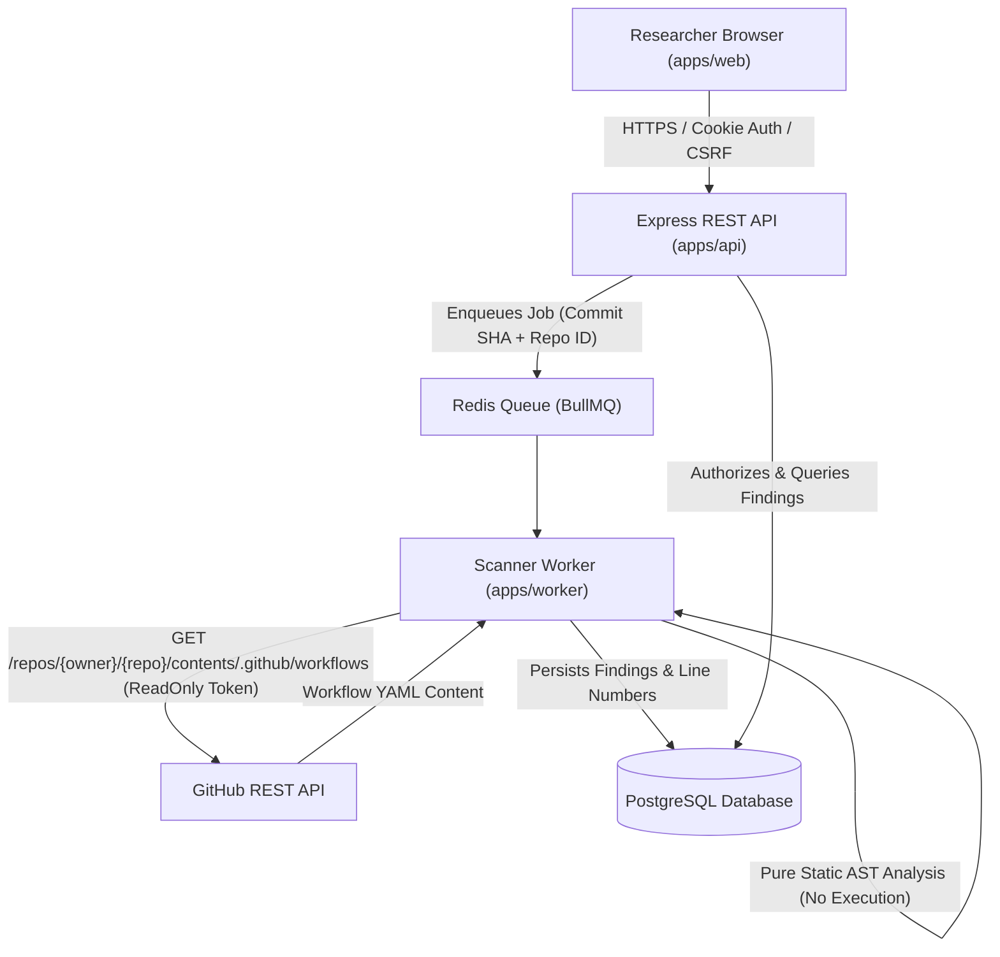

# Signal Architecture & System Specification

## 1. System Vision & Architecture Overview

**Signal** is an evidence-backed static analysis platform engineered for security researchers, bug bounty hunters, and AppSec auditors investigating CI/CD pipelines (GitHub Actions, GitLab CI, Jenkins).

Signal operates on a fundamental principle: **CI/CD configuration files are data, never executable code**. Workflows are fetched via authorized GitHub App installation tokens, parsed strictly into Abstract Syntax Trees (ASTs), and evaluated against versioned detection rules without executing arbitrary repository commands, downloading remote scripts, or triggering untrusted runners.

### Monorepo Workspaces

Signal is organized as an npm-native monorepo adhering to strict package boundaries:

```
├── apps/
│   ├── web/               # React 19 + Vite + Tailwind CSS v4 Marketing & App Frontend
│   ├── api/               # Express + TypeScript REST API (Auth, Quotas, Scans, Reports)
│   └── worker/            # BullMQ + Redis Background Scanner Worker
├── packages/
│   ├── database/          # Prisma Client, PostgreSQL models, migrations & connections
│   ├── shared/            # Shared DTOs, Zod schemas, AppError, logging, domain types
│   └── scanner-rules/     # Versioned static analysis rules, AST evaluation interfaces
├── docs/                  # Architecture specs, audit notes, implementation roadmap
└── .env.example           # Sanitized environment variable template
```

---

## 2. Workspace Responsibilities & Boundaries

| Workspace | Runtime | Primary Responsibilities | Dependencies & Invariants |
| :--- | :--- | :--- | :--- |
| `apps/web` | Browser (Vite/React 19) | Marketing landing page, interactive scanner telemetry demo, researcher console preview, auth forms, scanner dashboard. | Only depends on `@signal/shared`. Must never contain API secrets, GitHub private keys, or payment webhook secrets. |
| `apps/api` | Node.js (Express) | Authentication, session management, GitHub App OAuth & webhook processing, Razorpay billing, scan dispatch, entitlement enforcement. | Depends on `@signal/database`, `@signal/shared`, `@signal/scanner-rules`. Enforces all quota reservations on the server. |
| `apps/worker` | Node.js (BullMQ) | Consumes scan jobs from Redis queue, retrieves repository workflow files via GitHub App tokens, evaluates static rules, persists findings. | Pure backend worker. Must never execute shell steps or execute third-party actions. |
| `packages/database` | Node.js (Prisma) | PostgreSQL schema definitions, migrations, relational integrity, audit logs. | Isolates persistence logic from route controllers. |
| `packages/shared` | Universal (Node & Web) | Standard `ApiResponse<T>`, `ApiErrorResponse`, `AppError`, logging formatter, domain enums, Zod schemas. | Zero side-effects; safe for both browser and Node.js runtimes. |
| `packages/scanner-rules` | Node.js / Universal | 10 detection vectors, rule definitions, severity, confidence ratings, remediation recommendations. | Pure AST and string analysis logic; no network calls or external process spawning. |

---

## 3. Threat Model & Security Boundaries



### Critical Security Boundaries
1. **No Code Execution**: Repository workflow code, shell scripts, and third-party actions are treated strictly as structured text. No container, VM, or local subshell is ever spawned to execute scanned code.
2. **Credential Isolation**: GitHub App private keys (`GITHUB_APP_PRIVATE_KEY`), session secrets, database passwords, and Razorpay webhook secrets reside exclusively in server environments and are never bundled into client assets.
3. **Short-Lived GitHub Installation Tokens**: Tokens are generated on-demand per authorized repository installation and discarded after fetching workflow YAML. Users never supply their own tokens directly.
4. **Tenant Isolation**: Every scan request, finding retrieval, and repository action strictly verifies that `repository.installation.userId === session.userId`. Cross-tenant resource queries return generic `404 Not Found` or `403 Forbidden` responses.
5. **Secret Redaction**: Automated logging redacts tokens, authorization headers, cookies, passwords, and API keys using pattern-matching masks.
6. **Server-Enforced Quotas**: Client apps cannot dictate scan quotas, plan features, or subscription status. Entitlements are reserved and deducted via atomic transactions.

---

## 4. Design System & Aesthetic Tokens

Signal adopts a **premium dark cybersecurity aesthetic**: high-contrast, black-and-charcoal surfaces with restrained neon-green accents, clear monospace data readouts, and purposeful micro-interactions.

### Color Tokens
- **Ink Background (`--color-ink`)**: `#07080c` (deep cosmic charcoal)
- **Signal Green (`--color-signal`)**: `#3ee0a0` (primary terminal accent)
- **High Severity (`--color-high`)**: `#ff5c6a` (danger coral)
- **Medium Severity (`--color-medium`)**: `#ffb020` (warning amber)
- **Low Severity (`--color-low`)**: `#7aa2ff` (informational cobalt)

### Typography
- **Sans-Serif (`--font-sans`)**: `Instrument Sans`, system-ui, sans-serif
- **Monospace (`--font-mono`)**: `IBM Plex Mono`, monospace

### Accessible UI Primitives (`apps/web/src/components/ui.tsx`)
- `Button`: Primary, secondary, and ghost variants with explicit `focus-visible` keyboard rings.
- `Badge`: Semantic severity tags with optional pulsing status indicator dots.
- `Card`: Frosted glassmorphism surface (`.glass`) with subtle border elevation.
- `Container`: Centered 7xl layout boundary with responsive padding.
- `Reveal`: IntersectionObserver-driven scroll reveals with full `prefers-reduced-motion` compliance.

---

## 5. Shared API & Error Protocol

All API endpoints follow a predictable JSON envelope structure:

### Success Response (`ApiResponse<T>`)
```json
{
  "success": true,
  "data": { ... },
  "meta": {
    "requestId": "c1f7a28e-b5c4-42b7-a3d8-e7b8f9a0c1d2",
    "timestamp": "2026-10-26T12:00:00.000Z",
    "pagination": {
      "page": 1,
      "pageSize": 20,
      "totalItems": 42,
      "totalPages": 3,
      "hasNextPage": true,
      "hasPrevPage": false
    }
  }
}
```

### Error Response (`ApiErrorResponse`)
```json
{
  "success": false,
  "error": {
    "code": "VALIDATION_ERROR",
    "message": "Invalid repository URL provided",
    "details": { "field": "repository", "expected": "https://github.com/org/repo" },
    "requestId": "c1f7a28e-b5c4-42b7-a3d8-e7b8f9a0c1d2",
    "timestamp": "2026-10-26T12:00:00.000Z"
  }
}
```

---

## 6. Environment & Deployment Assumptions

- **Node.js**: `v20.x` LTS or `v22.x`
- **Database**: PostgreSQL 16+ with SSL enforced in production
- **Message Broker / Cache**: Redis 7+ with TLS
- **API Runtime**: Containerized Node.js (Docker) behind reverse proxy (e.g., NGINX / Cloudflare)
- **Frontend Hosting**: Static HTTPS distribution (Vercel, Cloudflare Pages, or CDN)
